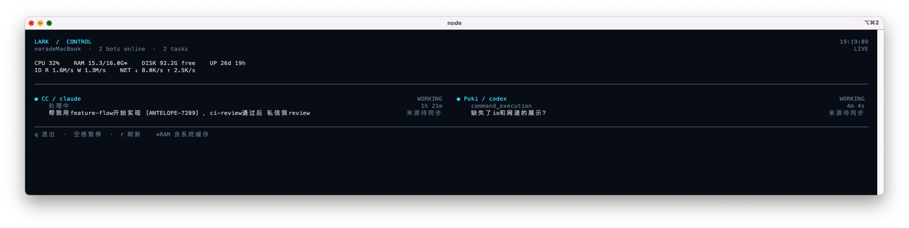

# lark-channel-bridge

A lightweight bot that bridges Feishu / Lark messenger with your local Claude Code or Codex CLI. Run one command, scan a QR code to bind a PersonalAgent app, and talk to your local coding agent from chat.

[中文 README](./README.zh.md)

For a product walkthrough, see the [Feishu document](https://larkcommunity.feishu.cn/docx/OaRIdFIRFoLM3xxTmKwcetHqn5e).

## What it does

- Forwards Feishu / Lark messages to local Claude Code or Codex CLI. Send a DM directly, or `@bot` in a group.
- **Streaming card**: text replies and tool calls update on one Lark card in real time; the footer shows a run clock and the current step, and flags a run that has gone quiet. A finished card gets a 「📋 复制」 button per code block in the answer (up to 6); a click makes the bridge send that block alone as a plain-text message, so long-press / right-click *Copy* takes it whole.
- **COT process messages**: optionally send a process message with agent progress text and tool calls, then send the final answer separately.
- **Session continuity**: each chat, topic, or document comment thread keeps its own session.
- **Queueing and batching**: messages sent in quick succession are handled together; messages sent during a run are queued for the next turn, while commands like `/new`, `/cd`, `/ws use`, and `/stop` can interrupt the current task.
- **Mid-run supplements**: while a run is going, a message from its starter or the bot owner that quotes the run's message or reply card, or starts with 「补充」「追加」「+」 (or 「/补充」「/追加」), goes straight to the running agent, which reads it after the current tool call; the message gets a 「Get」 reaction and the card a 「➕ 收到补充」 line. Codex takes them in app-server mode (`turn/steer`; a supplement the turn didn't read is handled as the next turn of the same run); under the `codex exec` fallback they queue as usual.
- **Auto-resume after the quota runs out**: a run that hits the plan's quota pauses and picks up again once the quota resets (Claude and Codex).
- **Task ledger resume**: the bot owner's long tasks pick up from their task ledger after an unexpected interruption (process killed, bridge restarted).
- **Multiple workspaces**: use `/cd` to switch the current project, and `/ws` to save and reuse common project directories.
- **Images and files**: send them to the bot directly, and the bridge downloads them locally for the agent.
- **Interactive cards**: `/help`, `/ws list`, and `/status` return cards with clickable buttons.

## Prerequisites

- Node.js **>= 20.12.0**
- At least one local agent installed and logged in:
  - Claude Code: `claude`, see https://docs.anthropic.com/en/docs/claude-code/quickstart
  - Codex CLI: `codex`, see https://developers.openai.com/codex/cli
- A Feishu / Lark **PersonalAgent** app. The first-run QR wizard can create and bind one for you.

## Install (this fork: build from source + npm link)

This repo is a customized fork, [`mirsery/lark-coding-agent-bridge`](https://github.com/mirsery/lark-coding-agent-bridge), with changes that are not in the npm package: a Sponsor line on reply cards, a task panel, a joint-debug help group, and more. **Do not install with `npm i -g lark-channel-bridge`**: that runs the upstream release and none of this fork's changes take effect.

```bash
git clone git@github.com:mirsery/lark-coding-agent-bridge.git ~/workspace/lark-coding-agent-bridge
cd ~/workspace/lark-coding-agent-bridge
pnpm install        # the prepare script also runs a build
pnpm build          # builds the web console and dist/
npm link            # points the global lark-channel-bridge at this checkout
```

Check that the global command points at this checkout rather than an npm install:

```bash
readlink -f "$(command -v lark-channel-bridge)"
# expected: ~/workspace/lark-coding-agent-bridge/bin/lark-channel-bridge.mjs
```

> With nvm, `npm link` lives under the current Node version's global directory. After switching Node versions, run `npm link` again and update the node path in the launchd plists.

## First run

Bind the PersonalAgent app once in the foreground, with an explicit profile and agent:

```bash
lark-channel-bridge run --profile claude --agent claude
```

The first run opens a QR-code wizard:

1. A QR code renders in your terminal.
2. Scan it with the Feishu / Lark app.
3. Pick or create a PersonalAgent app.
4. Config is written to `~/.lark-channel/config.json`.

If you already have a PersonalAgent app, add `--app-id cli_xxx` to skip app creation; the command prompts for the App Secret. For Lark global apps, add `--tenant lark`.

Once the bot can send and receive messages, stop the foreground process with `Ctrl-C` and switch to the background services below.

## How this machine runs it

Two launchd user agents stay resident. Both start at login and are kept alive by `KeepAlive`:

| launchd Label | Command | Purpose |
|---|---|---|
| `ai.lark-channel-bridge.bot.claude` | `lark-channel-bridge run --profile claude` | The Feishu bot "CC", backed by Claude Code |
| `ai.lark-channel-bridge.bot.supervisor` | `lark-channel-bridge run --web-ui` | Local web console |

Both set `LARK_CHANNEL_HOME=~/.lark-channel` and include nvm's Node bin directory on PATH.

Install the services the first time:

```bash
lark-channel-bridge start --profile claude   # writes and loads ai.lark-channel-bridge.bot.claude
lark-channel-bridge start --web-ui           # writes and loads ai.lark-channel-bridge.bot.supervisor
```

Day-to-day status and control:

```bash
lark-channel-bridge status --profile claude
lark-channel-bridge restart --profile claude
lark-channel-bridge stop --profile claude
```

The console picks a random port on every start, and records the URL, token included, in `~/.lark-channel/ui.json`. Open or print it with the `ui` command:

```bash
lark-channel-bridge ui           # open the console in a browser
lark-channel-bridge ui --print   # print the URL only
```

Note: the `claude` profile is hosted by its own per-profile daemon, so the console cannot take its runtime lock and may show it as not running. Trust `status --profile claude` and real Feishu traffic instead; see "Web console" below.

### Applying code changes

The daemon loads `dist/` once at startup, so after editing source you must build before restarting:

```bash
cd ~/workspace/lark-coding-agent-bridge
pnpm build
lark-channel-bridge restart --profile claude
lark-channel-bridge status --profile claude
```

To tell whether the running daemon is stale, compare `git log -1 --format=%ci` with `ls -la dist/cli.js`; a build older than the latest commit has not taken effect. A restart drops the bot for a few seconds, so do it when no task is running. Sending `/show-tasks` in Feishu shows what is in flight.

### Logs and data

- Bot logs: `~/.lark-channel/profiles/claude/logs/daemon/daemon-{stdout,stderr}.log`
- Console logs: `~/.lark-channel/profiles/supervisor/logs/daemon/`
- Structured logs: `~/.lark-channel/profiles/claude/logs/bridge-YYYYMMDD.jsonl`
- Sessions and in-flight runs: `~/.lark-channel/profiles/claude/sessions.json`, `runs.json`

## Background service

Use `run` for first-run setup and foreground debugging. After the bot can send and receive messages, stop the foreground process with `Ctrl-C`, then use an OS-managed service for background operation:

```bash
lark-channel-bridge start
lark-channel-bridge status
lark-channel-bridge stop
```

Install globally before using service commands. The daemon's launchd plist / systemd unit / Windows task records the bridge CLI path; if that path comes from an npm temp cache through `npx`, the daemon can break when the cache is cleaned. `run` is fine through `npx` as a one-shot foreground process.

Service commands install a per-profile service:

```bash
lark-channel-bridge start [--profile <name>]
lark-channel-bridge stop [--profile <name>]
lark-channel-bridge restart [--profile <name>]
lark-channel-bridge status [--profile <name>]
lark-channel-bridge unregister [--profile <name>]
```

Platform mapping:
- **macOS**: launchd user agent `ai.lark-channel-bridge.bot.<profile>`
- **Linux**: systemd user unit `lark-channel-bridge.bot.<profile>.service`
- **Windows**: Task Scheduler task `LarkChannelBridge.Bot.<profile>`, launched through a `.cmd` wrapper

Daemon logs are under `~/.lark-channel/profiles/<profile>/logs/daemon/`.

### Live terminal dashboard

See bot availability, current tasks, execution stages and elapsed time alongside CPU, memory, free disk space and host uptime. A single TUI uses standard ANSI controls without terminal-specific split panes or APIs. Purple section titles and solid green/yellow/red bars show CPU, memory and disk, with the latest 24 network samples as sparklines. In its own lane, the AlphaESS mascot, a cat in a cap, pushes an energy-storage cabinet on a cart back and forth, turning at each edge. When it walks left, the drawing is mirrored but the cabinet’s “A” logo stays readable. Below the metrics, each bot gets one bordered group: its name, agent and state on top, then its Sponsor and quota, then its sessions with state, summary, origin and elapsed time. The background and body text follow the terminal settings. Background detection automatically selects light or dark foreground colors for charts, headings and borders. Terminals without background queries use their native ANSI palette; `--theme light` / `--theme dark` overrides foreground colors without changing the terminal theme.



```bash
lark-channel-bridge monitor --interval 5
lark-channel-bridge monitor --profile codex --interval 5
lark-channel-bridge monitor --once
lark-channel-bridge monitor --json
```

Each group header shows the bot’s Sponsor and its five-hour and weekly usage as bars with reset times in the local timezone, including while idle; usage at 90% or more turns red, and an exhausted quota is marked `额度已用尽`. Account readings refresh asynchronously once a minute; unavailable values show `—`. One-shot and JSON output wait for the reading. With multiple Claude accounts, the header shows the account selected for the next task and its quota, falling back to that account’s latest run report. Groups keep a stable order. Windows at least 120 columns wide place groups side by side; narrower ones stack them. When space runs short, the header folds into one line, then the bot name alone, and sessions that do not fit are counted as `+N 个会话`.

The examples above refresh every five seconds; omitting `--interval` uses a ten-second sampling default. The mascot independently clears its previous position and updates only its own area at two frames per second, without collecting metrics or reading logs. Use `--no-animation` to disable animation; small viewports hide the mascot.

On macOS, physical disk read/write rates and physical network download/upload rates use counter deltas, excluding loopback and tunnel duplicates. Initial or unavailable samples show `—`; I/O sampling runs at most once every five seconds.

On macOS, install `osx-cpu-temp` (`brew install osx-cpu-temp`) to display CPU temperature as `TEMP`, sampled at most once every five seconds. Missing, unsupported or failed sensors show `—`. No sudo is required.

The layout adapts to the viewport: wide windows show session cards in two columns, ordinary windows stack them, and narrow windows compact host metrics. Resizing immediately reflows the cached snapshot without another sample.

Each task shows its chat name (or DM) and requester on the right, moving to a separate row in narrow windows. Names are captured when the task starts; refreshing makes no Feishu API calls. Older tasks or unresolved names display a pending label. Restart the bridge after upgrading to record origins for new tasks.

Working bots appear first, task summaries wrap and long URLs collapse to their final path segment. Press `q` to quit, space to pause or `r` to refresh. `--interval <seconds>` supports 0.5–60 seconds and `--no-color` disables colors. Non-interactive terminals print one snapshot; `--json` returns the full state.

The dashboard reads local state without requiring a bot restart. CPU utilization uses successive samples and is unavailable on the first frame. RAM shows non-free memory, including OS cache. Disk capacity is cached for 60 seconds; unchanged logs reuse parsed events, with each tail read capped at 256 KiB. Task stages come from real telemetry rather than estimated completion percentages, and exited or expired tasks are marked as interrupted.

### Web console (`--web-ui`)

`--web-ui` is an alternative background service, not an add-on to the per-profile daemons above. Add it to `start` to run one machine-wide supervisor process that hosts every profile and serves a local web console to start/stop/configure them:

```bash
lark-channel-bridge start --web-ui
```

Pick one mode per machine:
- **Per-profile daemons** (`start [--profile <name>]`, no `--web-ui`) — what the commands above set up. No web console.
- **Supervisor console** (`start --web-ui`) — one process hosts all profiles; the console reads their live status directly from that process.

⚠️ **Do not run both for the same profile.** If a profile already has a per-profile daemon running and you separately start `run --web-ui` / `start --web-ui`, the console tries to host that profile too, fails to acquire its runtime lock (already held by the other process), and silently falls back to showing it as **not running** — even though the original daemon is still alive and answering messages. The console currently only reports profiles it hosts itself; it does not detect profiles kept alive by another process. If you want the console, stop the per-profile daemon first (`lark-channel-bridge stop --profile <name>`) and let the console start it instead.

The console’s **运行概览** page shows the same data as the terminal dashboard. The top row shows host CPU, memory, disk and network. Below it, each bot has its own card, in a stable order, with its Sponsor and its five-hour and weekly quota bars with local reset times. Usage at 90% or more turns red, and a `额度已用尽` badge marks an exhausted quota. Each bot’s sessions are listed under it, showing the current step, elapsed time, summary, chat and starter. The page refreshes every five seconds. Runs hosted by the console process can be stopped from the page; runs owned by other processes are view-only.

### Multiple profiles: Claude and Codex

By default, the bridge starts with the currently selected profile. Use `profile use <name>` to change it. Each profile keeps its own app credentials, sessions, working directories, and logs. Create multiple profiles only when you need to connect multiple PersonalAgent apps, or run Claude and Codex as separate bots:

```bash
lark-channel-bridge start --profile claude --agent claude
lark-channel-bridge start --profile codex --agent codex
```

For example, to restart only the Codex bot:

```bash
lark-channel-bridge restart --profile codex
lark-channel-bridge status --profile codex
```

#### Adding a bot from an existing app

To attach another bot you already created on the Feishu / Lark Open Platform (instead of creating one through the QR wizard), create the profile with its App ID, then start it as a background service:

```bash
# 1. Log in the agent CLI first (Codex shown; Claude uses `claude` login)
codex login --device-auth

# 2. Create the profile from the existing app. Leave out --app-secret:
#    the command prompts for it, so the secret never lands in shell history.
lark-channel-bridge profile create codex \
  --agent codex \
  --app-id cli_xxxxxxxxxxxx \
  --workspace ~/workspace

# 3. Run it as an OS-managed daemon (autostart on login)
lark-channel-bridge start --profile codex

# 4. Check it
lark-channel-bridge status --profile codex
lark-channel-bridge profile list
```

Before step 2, make sure the app is ready on the Open Platform:

- **Bot** capability is enabled.
- **Event subscription** uses **long connection** and subscribes to *Receive messages* (`im.message.receive_v1`); otherwise the bot never sees a message.
- To cancel a task when its message is recalled, also subscribe to *Message recalled* (`im.message.recalled_v1`) and publish a version: a queued message is dropped; a run whose every message was recalled is stopped and its card says the message was recalled; a partly recalled run is told to disregard that message and goes on.
- The app is **not already bound to another profile**. Two profiles on one app both consume the same events and answer the same message twice.

Add `--tenant lark` for a Lark global app. Day-to-day management is the same as any profile: `restart` / `stop --profile codex`, or `lark-channel-bridge ui` for the web console.

Codex runs through `codex app-server` by default: later messages in a conversation go to the Codex process that is already up instead of starting a new one, an idle process closes after 10 minutes, and `/stop` interrupts the turn cleanly over the protocol. Profiles with `ignoreUserConfig`, or with execpolicy `.rules` files that `ignoreRules` must keep out, fall back to one `codex exec` per message; set `"transport": "exec"` in the profile's `codex` config to force that.

### Restarting a `npm link`'d local dev checkout

If `lark-channel-bridge` on your `PATH` is `npm link`'d to a local clone of this repo (`npm ls -g lark-channel-bridge` shows a symlink into the repo instead of a versioned npm install), the running daemon only reflects whatever was in `dist/` the moment it started — Node loads the built JS into memory once at process start and does not hot-reload. Editing source or even running `pnpm build` afterwards changes nothing for an already-running daemon.

```bash
pnpm build                                    # rebuild dist/ from current source
lark-channel-bridge restart --profile <name>  # reload it into the running daemon
lark-channel-bridge status --profile <name>   # confirm it came back up
```

Skipping the `pnpm build` step is the easy mistake — `restart` alone just relaunches the daemon against whatever `dist/` already exists on disk, silently stale if you forgot to build. To check without restarting: compare `git log -1` (latest commit) against `ls -la dist/cli.js` (last build time) — if the build predates the commit, the running daemon is out of date. Restarting drops the daemon's live connection for a few seconds; `KeepAlive` in the launchd/systemd service definition brings it back automatically, but time it for a moment nothing is mid-flight.

## Commands

### Host CLI

```text
lark-channel-bridge run [--profile <name>] [--agent claude|codex] [--workspace <path>] [-c <config>]
lark-channel-bridge migrate [--profile <name>] [--agent claude|codex]
lark-channel-bridge ps
lark-channel-bridge kill <id|#>
lark-channel-bridge --help
```

`profile use <name>` changes the profile used by later default starts. Use these profile management commands when running separate Claude / Codex bots, connecting multiple PersonalAgent apps, or doing scripted deployment:

```bash
lark-channel-bridge profile create claude --agent claude
lark-channel-bridge profile create codex --agent codex
lark-channel-bridge profile list
lark-channel-bridge profile use <name>
lark-channel-bridge profile remove <name>
lark-channel-bridge profile remove <name> --purge --yes
lark-channel-bridge profile export <name> [--output ./profile.json] [--force]
lark-channel-bridge profile export <name> --include-secrets --yes
```

`profile remove` archives local state by default, including the active profile. If other profiles remain, the bridge switches to the next one; if it was the last profile, the root config is cleared so the same name can be created again. `--purge --yes` permanently deletes local state. `profile export` redacts app secrets by default; `--include-secrets --yes` includes sensitive config.

If a profile was created with the wrong agent kind, stop or unregister any matching background service first, then run `profile remove <name>` and recreate it with the intended `--agent`.

### Slash commands inside Feishu / Lark

| Command | Effect |
|---|---|
| `/new`, `/reset` | Clear the current session |
| `/cd <path>` | Switch working directory and reset the session |
| `/ws list` | List named workspaces |
| `/ws save <name>` | Save the current working directory as a named workspace |
| `/ws use <name>` | Switch to a named workspace |
| `/ws remove <name>` | Delete a named workspace |
| `/resume [N\|all]` | Resume a conversation this chat has used (same agent, working directory, and permission mode); `all` lists every one, admins only |
| `/status` | Show profile, agent, working directory, session (current context size, time since the last exchange, and — with smart session compaction on — whether the next message starts a new conversation), lark-cli identity, run state, and any pending auto-resume; non-admins see only the current task and its resume time |
| `/config` | Adjust presentation preferences, access settings, and lark-cli identity policy |
| `/invite user @name` | Allow a user to use the bot in DMs |
| `/invite admin @name` | Add an access-control admin |
| `/invite group` | Allow the current group to use the bot |
| `/invite group restricted @name...` | Allow the current group, limited to the named people only |
| `/invite member @name` | Add a person to the current group's member allowlist |
| `/invite all group` | Allow all groups the bot has joined |
| `/remove user @name`, `/remove admin @name`, `/remove group [chat id]`, `/remove member @name` | Remove access entries; `/remove group <chat id>` drops the named group by full id or trailing characters, also from a DM |
| `/stop` | Stop the current run, including the card stop button; with nothing running, cancel a pending auto-resume |
| `/timeout [N\|off\|default]` | Set or clear the current session idle watchdog |
| `/memory [add\|forget\|clear]` | Cross-session memory; `--global` writes profile-wide |
| `/skills [show <name>]` | The skill index the agent reads on demand |
| `/knowledge [bind\|sync\|unbind]` | Git sync for memory and skills |
| `/knowledge lib [add\|sync\|write\|rm]` | Subscribe to other knowledge repositories; writable only in a write window (owner only) |
| `/dream [run\|cancel\|prs\|diff\|revert]` | Dream consolidation: turn finished conversations into memory / skill Draft PRs (admins, DM only) |
| `/diff [staged\|<ref>]` | Show the working tree's changes, with the full patch attached when long |
| `/worktree [add\|use\|remove]` | Manage task worktrees; the session follows the new one |
| `/pr [number\|url]` | Pull request, CI and review status for the current branch |
| `/cron add [--name <name>] <when> \| <task>` | Create a scheduled job |
| `/cron list\|show\|run\|pause\|resume\|rename\|remove` | Manage scheduled jobs |
| `/ps` | List local bridge processes |
| `/exit <id\|#>` | Stop a bridge process |
| `/reconnect` | Force a WebSocket reconnect |
| `/doctor [description]` | Run low-sensitive diagnostics |
| `/usage [today\|week\|month]` | Token and estimated-cost usage; everyone sees their own, admins see everyone in a private chat |
| `/accounts` | Claude subscription accounts: 5-hour / weekly usage, resets, switch lines and score per account; `/accounts switch [name or id]` changes which account new runs use (the best-scoring one with room when no name is given). Admins only |
| `/audit [blocked] [N]` | Who had the bot run which commands / change which files, and approval outcomes; `/audit blocked` lists only the steps the guest guard refused, to catch misjudgments (admins, private chat) |
| `/help` | Help card |

DMs do not require an @ mention. Groups and topic groups require `@bot` by default; `@all` is ignored. Cloud-doc comments in supported document types run when the bot is mentioned.

**Group context**: Feishu only delivers the messages that @ the bot, so the rest of a group discussion is invisible to it. Before each run in a group or topic, the bridge reads back the messages the bot never received and attaches them to the prompt as background:

- First time in a topic: the topic's existing messages (up to 40).
- First mention in a regular group: the latest 20 messages from the past 12 hours.
- After that: only what others said since the bot's previous reply (up to 30, excluding its own replies).

Messages over 4000 characters are cut, and the oldest are dropped when the total runs long. How far each conversation has been read is kept in the profile's `chat-context-cursors.json`, so a restart doesn't inject anything twice. DMs skip this step.

## Memory and skills

Each profile owns a knowledge directory the bot carries across sessions, so a rule you teach it in one conversation is not gone the moment the session resets.

Every run injects a `<bridge_knowledge>` block containing:

- **Profile memory** — notes that apply to every chat this profile serves.
- **Chat memory** — notes scoped to the current chat or topic. A topic in a topic group also gets its group's notes (written with `/memory add --group`); topics never see each other's. On a conflict, the chat's notes win.
- **A skill index** — name, one-line description, and the path of every `SKILL.md`. Only the index. The agent opens a skill's body itself when the task calls for it, so a dozen skills cost a few dozen tokens per turn instead of thousands.

```text
/memory                       # what is in effect here
/memory add <text>            # remember it for this chat
/memory add --group <text>    # in a topic: remember it for the whole group
/memory add --global <text>   # remember it profile-wide (admins)
/memory forget <id>
/memory clear [--group|--global]
/skills                       # the skill index
/skills show <name>
```

Anyone allowed to use the bot in a chat can write that chat's notes; profile-wide memory and the knowledge repository are admin-only, and a member cannot delete a global note by guessing its id.

### Where it lives, and syncing it

```text
~/.lark-channel/profiles/<profile>/knowledge/
  MEMORY.md                 # profile-wide notes
  chats/<scope>.md          # per-chat notes
  skills/<name>/SKILL.md    # reusable instructions
```

It is plain Markdown at `0600`, editable in any editor — and that is the point: the directory is meant to be a git repository.

```text
/knowledge                       # counts, remote, sync state, auto-sync state
/knowledge bind <git-url>        # bind a remote and pull what is already there
/knowledge sync                  # sync now: commit local edits, pull, push
/knowledge unbind                # keep the content, drop the remote
```

Binding merges instead of overwriting, so notes written before you had a remote survive. The same repository can back several profiles and several machines, and `gh`/`git` credentials stay the ones already on that machine. `/status` shows the counts and the sync state in one line.

- **Auto-sync**: once a remote is bound, the bridge syncs shortly after start-up and then every 30 minutes (commit → `pull --rebase --autostash` → push), so bots sharing one repository see each other's memories without anyone running `sync`. Set the interval in the profile's `knowledge` section; `0` turns it off (manual `/knowledge sync` only). Changes apply on `/reconnect` or restart (or edit it in the Web console, see below):

  ```json
  "knowledge": { "syncIntervalMinutes": 30 }
  ```

- **No overlapping git runs**: auto-sync and the manual `/knowledge sync` / `bind` / `unbind` queue up per directory. When two bots push at the same moment, the loser pulls once more and pushes again.
- **Line-wise merge for memory files**: the knowledge repository gets a `.gitattributes` with `MEMORY.md merge=union` and `chats/*.md merge=union` (missing lines are appended, existing content is kept, committed on its own), so two bots appending to the same memory file at once keep both lines instead of conflicting. The trade-off: a memory deleted on one side can come back if the other side appended next to it at the same time. `MEMORY.md` has no directory prefix, so memory indexes of that name under `notes/` merge the same way.
- **Web console**: the Knowledge card on the Configuration page shows the remote, branch, ahead/behind counts, uncommitted changes and auto-sync state, and can bind / rebind / unbind the remote, sync now and change the interval. Git work runs on the spot; the interval applies at once for profiles the console hosts, and is written to the config for profiles hosted by another process (per-profile daemons), taking effect on their next restart.
- **Failure alerts**: every failure is logged; after two failed auto-sync rounds in a row the bot owner gets one DM (git's first error line, the knowledge directory, credentials in URLs masked), nothing more until it recovers, then a one-line "recovered" note. A successful manual `/knowledge sync` also ends the streak. A directory left mid-merge / mid-rebase is not auto-synced until someone finishes that.

Skills are read by both Claude and Codex through the same index, so one file serves whichever agent a profile runs.

### Shared skill libraries

The knowledge directory belongs to one profile. To let several bots (say CC on Claude and Poki on Codex) use the same skills, keep them in a git repository and load it as a **skill library**. The bridge keeps a read-only mirror of each library and merges its skills into the same index; entries carry a `source` naming the library they came from.

```text
/skills lib                                   # configured libraries, sync state, skills each one loaded
/skills lib add <git-url> [name]              # add a library and pull it now (not saved if the pull fails)
    [--external]                                # a third party's library: pinned at the fetched commit
    [--ref <branch/tag/commit>] [--path <dir>]
    [--only a,b] [--exclude a,b]
/skills lib sync [name]                       # pull now; external libraries only fetch and list the difference
/skills lib update <name>                     # move an external library to its remote's latest commit
/skills lib rm <name>                         # remove it, mirror included
```

- **Own and third-party libraries**: each library has an `owner`. Your own (`self`, the default) follows its remote on every sync and is where dream consolidation proposes new skills. A third party's (`external`, added with `--external`; any number of them — a department's, a marketplace's) is maintained by someone else and its content becomes the bot's instructions the moment it changes, so it stays at the commit recorded in `pin`: `sync` and the scheduled sync only fetch, and `/skills lib` shows how many commits the remote is ahead and which skills it adds, changes or removes; an admin moves the pin with `/skills lib update <name>` after reviewing that. External libraries are never a dream consolidation target, and their index entries carry `external: true`.

- **Layout**: skills live at `skills/<name>/SKILL.md`; without a `skills/` directory the repository root is scanned, and `--path` picks another directory. A repository whose root is a single `SKILL.md` counts as one skill. Frontmatter may use quoted values and `>` / `|` multi-line descriptions.
- **Read-only mirror**: a sync is fetch + check out the remote commit + drop local changes, never a merge. Change a skill in the library's own repository.
- **Name clashes**: the profile's own `knowledge/skills/` win, then your own libraries, then third-party ones, each group in the order added; the losers are listed in `/skills lib`.
- **Syncing**: once at start-up, then every 60 minutes (`skills.syncIntervalMinutes`; `0` pulls only at start-up and on `sync`).
- **Permissions**: `/skills lib` is admin-only — a library's content becomes instructions the bot follows; `/skills` stays readable for everyone. Reach private repositories through the SSH key already on the host rather than a token in the URL (cards and logs mask credentials, the config file does not).
- **Config**: stored in the profile's `skills` section:

```json
"skills": {
  "libraries": [
    { "name": "team-skills", "owner": "self", "url": "git@github.com:acme/team-skills.git", "ref": "main", "exclude": ["old-skill"] },
    { "name": "dept-skills", "owner": "external", "pin": "<40-char commit id>", "url": "git@github.com:dept/skills.git" }
  ],
  "syncIntervalMinutes": 60
}
```

Entries without `owner` (written before it existed) read as `self`; the field is filled in on the next config save.

Mirrors live in `~/.lark-channel/profiles/<profile>/skill-libraries/<name>/`. Each profile configures and pulls its own; to share a library between bots, `add` it in each of them.

The Skill libraries card on the Web console's Configuration page does the same: it lists libraries grouped into your own and third-party ones with each one's commit, last sync and loaded skills (shadowed ones struck through) plus, for third-party ones, the upstream difference, and can add a library (saved only after the pull succeeds; tick "third-party" for `--external`), sync one or all, update a third-party one, remove one and change the interval. Pulls and mirror removal run on the spot; config changes apply at once for profiles the console hosts, and on the next restart for profiles hosted by another process — if such a process re-pulls a removed library before then, the mirror is swept at its start-up because the config no longer lists it.


### Subscribed knowledge libraries (a department's shared repository…)

Besides its own knowledge directory, a profile can subscribe to knowledge repositories other people maintain. The bridge keeps a read-only mirror of each, follows the remote, and puts the title and first sentence of the selected Markdown files into every run's index (`libraryKnowledge` in `<bridge_knowledge>`); bodies are read on demand.

```text
/knowledge lib                                           # subscribed libraries, pull state, write windows (also on the /knowledge card)
/knowledge lib add <git-url> [name] [--read glob,glob] [--self dir] [--ref branch]
/knowledge lib sync [name]                               # pull now
/knowledge lib write <name> [minutes]                    # open the write window (default 120 minutes); `off` closes it
/knowledge lib write <name> job <job id>                 # open it whenever this scheduled job (the weekly bot meeting) runs; again to undo
/knowledge lib write <name> skill <skill name>           # open it whenever the agent reads this skill (bot-weekly-meeting), however the meeting started; again to undo
/knowledge lib rm <name>                                 # unsubscribe, deleting the mirror and work clone
```

- **Index**: `--read` globs pick the files (`*` within a directory, `**` across; default every `.md`, repository docs such as README excluded). Entries under `shared/` are `authoritative`, those under the bot's own directory (`--self`) `own`, those in sibling directories (other bots') `personal`. Precedence: chat memory > profile memory > authoritative > others > personal notes; the index has its own budget and drops personal notes first.
- **Read-only**: a mirror's push URL leads nowhere and every sync resets it to the remote. Guest runs may read mirrors, never write them.
- **Write window**: a library with `--self` is read-only too, except while a window is open (for three hours after a bound job fires or the agent reads a bound skill, or after the owner ran `/knowledge lib write`). Then the bridge prepares a writable clone in `knowledge-libraries/<name>.work/` and lists it under `libraryWrite`. The agent commits and pushes there with plain git; hooks refuse anything outside the window, anything but the bot's own directory on the default branch (shared directories go through a branch and a Draft PR), content or messages that look like credentials, SNs, IPs, e-mail addresses, ticket numbers or internal host names, and AI attribution in commit messages. Closing the window deletes the clone unless it holds unpushed work. Skill bindings work with Claude only (a PreToolUse hook on Read), in the owner's chats and the owner's scheduled jobs, and only for the `SKILL.md` in the skill index — a same-named skill inside the library opens nothing.
- **Permissions**: `/knowledge lib` is for the bot owner only (not admins).
- **Config**: the profile's `knowledge` section; libraries pull on the same `syncIntervalMinutes` as the knowledge directory:

```json
"knowledge": {
  "syncIntervalMinutes": 30,
  "libraries": [
    { "name": "dept-kb", "url": "git@github.com:dept/kb.git", "read": ["shared/**", "bots/*/notes/**"], "write": { "self": "bots/cc", "jobs": ["<job id>"] } }
  ]
}
```

Dream consolidation never writes to these libraries.

### Dream consolidation (梦境整理, off by default)

Rules agreed in a chat, verified conclusions and procedures that worked are easy to forget to `/memory add`. With dream consolidation on, an admin can have the bot go back over finished conversations and turn what is worth keeping into **Draft PRs for review**: memory and notes against the knowledge repository, skills against a shared skill library. Nothing takes effect before a human merges; the bridge never merges.

```text
/dream                 # switch, target repositories, limits, why automatic rounds did not run, recent runs, PRs awaiting review
/dream run             # run one round now; the outcome is posted back in the DM
/dream cancel          # stop the running round (cursors do not move, it is re-read next time)
/dream prs             # PRs it opened and their review state
/dream diff [batch]    # the diff of a batch (default: the latest)
/dream revert <batch>  # undo a batch: a revert Draft PR if merged, otherwise a pointer to close the PR
```

- **Switch**: 「梦境整理」 in `/config` or under Configuration → Replies & runs in the Web console; off by default. Switching it off stops a running round before it publishes. `/dream` is admin-only and works only in a DM, since a round reads every chat.
- **Automatic rounds** (「自动整理」 in `/config` / the Web console, off by default, effective only with dream consolidation on): not a daily job — a round starts **once enough has piled up**. Every 30 minutes the bridge checks, and starts a round only when all of these hold: inside the allowed hours (default 01:00–07:00, at most one round per window); enough material (5 scopes with new exchanges, or 60,000 characters of new conversation); 3 days since the last round; the previous batch reviewed (fewer than 1 open dream PR per target repository); the profile idle (no user run running or queued, no new message in the last 30 minutes); and the agent account's quota under 80%. After 14 days without a round any new input is enough. With the quota unreadable it runs on half the budget; it never spends a Codex rate-limit reset credit. An automatic round yields to a user message (cancelled, re-read next time) until its drafts are committed; a manual `/dream run` does not yield. From the second failure in a row it backs off 2, 4… days, and after 3 it pauses until a manual round succeeds. Automatic rounds send no messages — results and why nothing ran (e.g. "材料不足 3/5 个会话范围", "距上次整理 1/3 天") show in `/dream` and the Web card.
- **Input**: only conversations the bridge itself ran (Claude's session transcript, Codex's rollout, located by the session handle — nothing else on the host is scanned), and only each request and the final answer, no tool calls or progress. Scheduled jobs, meetings and doc-comment sessions are skipped. Each conversation has a cursor so the next round reads only what is new; a rewritten transcript is re-read from the start, and anything proposed before is not proposed again. Conversations still in progress (idle under 30 minutes) or running right now wait for a later round.
- **Consolidation**: each scope (a group, DM or topic) gets its own read-only agent run (plan mode for Claude, the read-only sandbox for Codex; if read-only cannot be guaranteed it does not run), seeing only that scope's conversations, the profile-wide memory, that chat's memory and the skill index. Works for Claude and Codex profiles alike, with the profile's own agent.
- **Validation**: the agent only suggests; each item is checked before anything is written — it must cite turns that exist in this round's input; promoting to profile-wide memory needs an admin saying it directly in their own message, otherwise it is kept for the originating chat only; merge / conflict / stale are flags written to `notes/<scope>/dream-review.md`, the original entries are not touched; anything that looks like a key, token or credential is dropped (and masked out of the excerpts the agent sees); file paths are derived by the bridge from the scope, never taken from the agent.
- **Publishing**: a fresh clone of the remote's latest state, one commit on a `dream/<batch>` branch, a push of that new branch and a Draft PR — no force push, never the default branch, repository hooks off. Every target repository is committed locally first; only when all succeed is a checkpoint recorded (cursors move, candidates are marked proposed). A failure or cancel before the checkpoint drops the whole batch to be re-read next time — never half a batch of PRs. Pushes and PRs interrupted after the checkpoint (restart, network) are resumed by the next round, never opened twice. The PR body lists each item's reason and source (conversation, scope, turns), what was downgraded and what was left out. Delete what you do not want in the PR, or close it to drop the batch (the same candidates are not proposed again); for one already merged, `/dream revert <batch>` opens a revert Draft PR.
- **Bots sharing a repository**: when two profiles (say CC and Poki) are bound to the same knowledge repository or skill library, a round takes a host-wide lock per repository remote before it starts; if another one is consolidating the same repository, this round does not run and says who holds it.
- **Targets**: existing configuration — the knowledge repository's `origin` from `/knowledge bind`; new skills go to the only library in `skills.libraries` (with several, name one in `preferences.dreamTuning.skillLibrary`), updates go back to the library the skill comes from. A library the current `gh` account cannot write to, or one pinned to a tag / commit, is skipped and reported. When `gh` is unavailable, or opening the PR fails for a moment, the draft stays local and the next round pushes it and opens the PR first; with automatic rounds on, every check also retries it first (an unopened draft counts toward the review backlog).
- **Limits** (optional, profile `preferences.dreamTuning`):

```json
"dreamTuning": {
  "maxSessions": 20,
  "maxInputChars": 120000,
  "maxRunMinutes": 20,
  "minIdleMinutes": 30,
  "skillLibrary": "team-skills",
  "scopes": ["oc_xxx"],
  "window": "01:00-07:00",
  "timezone": "Asia/Shanghai",
  "minScopes": 5,
  "minInputChars": 60000,
  "minIntervalDays": 3,
  "maxIntervalDays": 14,
  "maxOpenPrs": 1,
  "maxAutoFailures": 3,
  "maxQuotaPercent": 80
}
```

With `scopes` set only those scopes are read. `window` may wrap midnight (`22:00-06:00`); `timezone` defaults to the host's; `maxIntervalDays: 0` turns the fallback off. These live in the config file only — `/config` and the Web console have just the switches. Local bookkeeping (cursors, PRs opened — no conversation text) is in the profile's `dream-state.json`; draft checkouts live under `dream/`, only the last few rounds are kept.

The Web console's Configuration page has a 「梦境整理」 card with the targets, limits, the automatic-round conditions and the last check, recent rounds (automatic ones marked 「自动」) and PR links; for a profile the console hosts it can start, cancel or revert a round, for one run by another process it shows status only — use `/dream run` / `/dream revert` in a Feishu DM.

## Git awareness

When a session's working directory is a git repository, the bridge stops being blind to it.

- **`/status`** gains a git line: branch, divergence from upstream (`↑2 ↓1`), what is uncommitted, and whether the directory is a linked worktree.
- **`/diff [staged|<ref>]`** renders the change set as a card: per-file `+`/`-` counts, untracked files, and an inline excerpt of the patch. `/diff` alone means everything uncommitted, `/diff staged` only what is staged, and `/diff main` what this branch adds relative to `main` (from their merge base). When the patch does not fit inline, the full thing follows as a `.patch` file you can open anywhere.
- **`/worktree`** manages task worktrees. `/worktree add <branch> [base]` creates one **beside** the repository (`../.worktrees/<repo>-<branch>`, never inside it, so it cannot pollute the parent repo's own status or file scans), then points the session at it and resets the session — the same contract as `/cd`. `/worktree use <branch|path>` switches between existing ones, `/worktree remove <branch|path> [--force]` deletes one. The main checkout and the tree the session is currently standing in are protected.
- **`/pr [number|url]`** shows the current branch's pull request — title, `head → base`, review decision, and the CI rollup with the names of failing checks — plus a refresh button.

`/pr` shells out to the [GitHub CLI](https://cli.github.com) and uses **your** `gh` login, so the bridge never needs a GitHub token of its own. With `gh` missing or logged out it says so instead of failing silently. Everything else here only needs `git`; a workspace that is not a repository simply keeps the old behaviour.

Refs that arrive from chat are validated before they reach git, so a message can never turn into a different git command.
## Scheduled jobs

`/cron` runs a prompt on a schedule and posts the result back into the chat that created it — a daily log sweep, a pre-release check, a reminder that actually does the work.

```text
/cron add 0 9 * * 1-5 | summarize yesterday's CI failures
/cron add @daily | sweep the error log and flag anything new
/cron add in 30m | check whether the deploy finished
/cron add at 2026-10-01 09:30 | draft the monthly report
/cron add --name "CI daily" 0 9 * * 1-5 | summarize yesterday's CI failures
```

- **Schedule syntax**: standard 5-field cron (`minute hour day-of-month month day-of-week`, with lists, ranges and `*/step`), the `@hourly` / `@daily` / `@weekly` / `@monthly` aliases, plus `in <duration>` and `at <time>` for one-shots. Everything is evaluated in the host machine's local timezone. `|` separates the schedule from the task.
- **One scope per job**: a job runs under its own session scope (`cron:<id>`) in the working directory that was current when it was created, so it never collides with the chat's own session. `--continue` reuses one conversation across fires; the default starts fresh each time.
- **Delivery**: the result arrives as one finished message (card or markdown, following `/config`) rather than a live stream — nobody is necessarily watching when a job starts. A job created in a topic replies inside that topic.
- **Access**: `/cron` is admin-only, and the creator's access is re-checked on every fire — revoking someone's access also disarms the jobs they left behind. Jobs are managed only from the chat that owns them.
- **Timing**: only the process hosting the profile ticks the scheduler, so a job never double-fires; nothing runs while the bridge is down. A cron fire missed by more than 6 hours is skipped rather than replayed (a laptop that slept through 09:00 and woke at 10:00 still runs it); a one-shot always fires, even late.
- **Failures**: a failed run is reported in the chat, and five consecutive failures disable the job. `/cron resume <id>` re-arms it and clears the streak.
- **Stopping**: `/cron pause <id>` and `/cron remove <id>` also interrupt that job's run if one is in flight — a scheduled run owns its own scope, so the chat's `/stop` does not reach it.

Jobs are stored per profile in `jobs.json` (see Data directories).


## Reply Display and COT

`/config` controls three presentation settings:

- **Message reply mode**: `message card` streams the final reply; `plain text` sends once after the run finishes.
- **Tool-call display**: controls whether tool blocks appear in the final card / markdown reply.
- **COT process message**: `off` sends only the final reply; `brief` first sends a COT message with agent progress text and tool summaries; `detailed` also includes tool args and truncated output.

When COT is enabled, the bridge splits the process view and final answer into two messages. The COT message is for tracing what the agent did; the final answer is still generated from the agent's raw text, without heuristic bridge-side filtering. If an agent emits final-answer text as ordinary stream text, that text can also appear in the COT process message.

### Long-run completion notice

The reply card is posted when a run starts and then updated in place, and Feishu doesn't push edits — a run that finishes twenty minutes later does so silently. So when a run takes longer than a threshold (default 5 minutes) from submission to finish, the bot posts one short follow-up reply to the original message:

- Groups / topics: it @-mentions the people who started the run (everyone in a merged batch; never bots) and says whether it finished or failed, and how long it took.
- DMs: only when the answer landed in that in-place card; when the answer was already sent as its own message (COT, plain-text mode, or Codex) that message pushed, so nothing is added.
- Runs the user stopped with `/stop` get no notice.

The threshold is the profile's `preferences.longRunNoticeMinutes` (minutes, `0` turns it off), config-file only.

### Progress card

- **Run clock**: while a run is going, the card footer shows the current step, the elapsed time and how long ago the agent last did anything, refreshed every 15 seconds — so a live run never looks frozen. After 3 minutes without activity it is flagged with ⚠️.
- **Current step**: during a tool call the footer shows the agent's own one-line description when it is in Chinese (never the raw command, which can carry hosts or tokens), otherwise just the tool name. While a subagent works, its current step shows too; its own output stays out of the card — only the main agent's answer goes in.
- **Oversized answers**: Feishu caps card size. An answer too long for the card is truncated there and sent in full as a separate message.
- **Failed card updates**: when Feishu rejects a card update (over the limit, card deleted), the bridge says so in the chat and sends the answer on its own, so it never gets stuck in a frozen card.

### Auto-resume when the quota runs out

When the Claude or Codex plan's quota (5-hour or 7-day window) runs out, the run isn't a failure: the card is marked 「额度用完，已暂停」 (orange) with when the quota resets and when the run continues. At that time (one minute after the reset) the bridge picks the task up in the same conversation, in a new card, and notes on the old card that it went on.

- For Codex the reset time comes from the quota windows read in the same process (read-only, never spending a reset credit), else from the error text.
- When the agent didn't say when the quota resets, it retries after 30 minutes. A task auto-resumes at most 6 times.
- The resume runs on behalf of whoever started the task, and their access is checked again when it fires.
- Pending resumes are kept in the profile's `auto-resume.json` and survive a restart. `/status` shows the resume time; the starter, admins and `access.stoppers` can cancel it with `/stop`.

### Several subscription accounts: switch when the quota runs out (Claude)

A Claude profile can hold several subscription accounts. When the current one reaches its switch line or runs out, the run moves to the next account and resumes the same conversation; once the main account resets, new runs go back to it.

- **Accounts**: `default` is the local claude CLI's own login; extra accounts are long-lived `claude setup-token` tokens, passed to that one claude process as `CLAUDE_CODE_OAUTH_TOKEN`. Only the credentials differ — config directory, transcripts, settings and skills are still the one `~/.claude`, so `--resume` works across accounts.
- **Adding and managing**: run `claude setup-token` in a terminal and log in with the **extra account** in the browser to get a token, then:

  ```bash
  lark-channel-bridge claude-account add <id> --label <name> --profile claude   # paste the token without echo, or pipe it with --token-stdin
  lark-channel-bridge claude-account list --profile claude
  lark-channel-bridge claude-account set <id> [--label <name>] [--five-hour <percent>] [--weekly <percent>]   # 0 follows the default
  lark-channel-bridge claude-account lines --five-hour 98 --weekly 90   # default switch lines
  lark-channel-bridge claude-account order <id> <id> …   # preference order; the first is the main account
  lark-channel-bridge claude-account switch [id]          # same as /accounts switch
  lark-channel-bridge claude-account remove <id> --profile claude
  ```

  `add` checks the token with a tiny haiku request first (`--no-verify` skips it). Tokens are stored encrypted in the profile keystore; the list is `claude-accounts.json` (order = preference). A running bridge re-reads it by mtime before each run, so **adding or removing accounts needs no restart**.
- **Which account**: each account has a switch line for the 5-hour and the weekly window (its own, else the default; both 98% by default). Accounts below their lines are used first, in order; once all are past their lines, each is used in order until it is refused; only when all are exhausted does the run pause, resuming when the earliest account resets (see the previous section).
- **Mid-run**: when refused, the run moves to the next usable account and `--resume`s the conversation. Claude reports usage once per message, after its first request; if that shows the line crossed and another account is below its lines, the switch happens at the next gap with no tool, subagent or background task in flight, so a very long message may go slightly past the line. The new account re-reads the whole conversation (caches don't cross accounts) and pays for that. Runs stopped with `/stop` and background follow-up turns never switch.
- **Display**: the reply card's `Sponsor:` is the account actually paying; a switch adds a line to the answer saying why (e.g. the 5-hour window reached its 80% line). Admins see the table with `/accounts` and switch by hand with `/accounts switch`.
- **The auto-dream quota gate** reads the account with the most room: as long as one account has room, the quota isn't tight.

With a single account (no `claude-accounts.json`) nothing switches: a run that runs out pauses and auto-resumes as before, and `/accounts` still shows that account's last reported usage.

### Task ledger: long tasks continue after an interruption

For big tasks (likely over 30 minutes, or split into subtasks) the agent first writes a task ledger at `~/.lark-channel/tasks/<task>.md` — goal, milestones, each one's status and output, next step — and puts `📒 任务台账：<path>` on a line of its own in the reply.

For tasks the **bot owner started in person** only: when one is interrupted unexpectedly (process killed, bridge restarted or crashed), after 30 seconds the bridge has the agent read the ledger and `git log` and continue from the next step, without redoing finished work — at most 3 times per task. A run stopped with `/stop` is not resumed, and neither is anyone else's.

### Kickoff inbox: a new topic starts without waiting for a reply

When a skill opens a topic and wants the bot to get going right away, it writes the task as a JSON file into `~/.lark-channel/profiles/<profile>/kickoffs/` (write `<name>.tmp`, then rename it to `<name>.json`):

```json
{ "chatId": "oc_…", "chatType": "group", "threadId": "omt_…",
  "senderId": "ou_…", "originMessageId": "om_…", "prompt": "…" }
```

Every 3 seconds the bridge takes one: it checks `senderId`'s access again, treats the prompt as if they had sent it in that conversation, replies under `originMessageId`, and queues it like any message. The file is deleted when taken; a failure is not retried. Claude runs someone else started can't reach the bridge directory, so they can't leave one.

## lark-cli identity policy

Each profile uses a profile-local lark-cli directory at `~/.lark-channel/profiles/<profile>/lark-cli`. The agent process receives `LARKSUITE_CLI_CONFIG_DIR` for that directory, so personal authorization in one profile is not shared with another profile.

The default policy is `bot-only`: lark-cli uses the app/bot identity and does not access personal resources. When a user authorizes personal resources such as calendar, mail, or drive, the current profile can switch to `user-default`, which keeps app identity available and also allows the authorized user identity. Owner/admin users can inspect or change this policy in `/config`; `/status` shows the current summary as `lark-cli: app` or `lark-cli: user-ready`.

## Working directories

Each profile may define a default working directory through `workspaces.default`. New profiles may be created with `--workspace <path>`; if omitted, the bridge creates a profile-managed default working directory.

This is a profile-field snippet. Do not replace the whole `config.json` with it; edit the matching profile's `workspaces` field.

```json
{
  "workspaces": {
    "default": "/Users/me/.lark-channel-workspaces/claude/default"
  }
}
```

The bridge checks that a selected directory exists, is a directory, and is not an overly broad location such as `/`, the home root, a system directory, or a temp root. The working directory is only the current directory for an agent run. It is not a filesystem sandbox; actual file access still depends on the local agent process and its permission mode.

## Permission modes

The recommended user-facing profile config is `permissions.defaultAccess` and `permissions.maxAccess`. New profiles default to `full` for both values so the bridge can keep local tools, authorization flows, file writes, and other agent features fully usable. To tighten a profile, set one or both values to `workspace` or `read-only`; stricter modes can limit local tool execution, login/authorization flows, file writes, and similar capabilities.

This is a profile-field snippet. Do not replace the whole `config.json` with it; edit the matching profile's `permissions` field.

```json
{
  "permissions": {
    "defaultAccess": "full",
    "maxAccess": "full"
  }
}
```

Mode mapping:

| Bridge access | Claude permission mode | Codex mode |
|---|---|---|
| `full` | `bypassPermissions` | `danger-full-access` |
| `workspace` | `acceptEdits` | `workspace-write` |
| `read-only` | `plan` | `read-only` |

The legacy `sandbox` field is still readable for old configs. After the bridge saves the profile, it migrates that setting to canonical `permissions`.

## Data directories

| Path | Content |
|---|---|
| `~/.lark-channel/config.json` | Root config with profiles and active profile |
| `~/.lark-channel/active-profile` | Last selected profile |
| `~/.lark-channel/profiles/<profile>/sessions.json` | Session state |
| `~/.lark-channel/profiles/<profile>/sessions.json.catalog.json` | Agent-aware session catalog |
| `~/.lark-channel/profiles/<profile>/knowledge/` | Memory and skills (optionally a git repo) |
| `~/.lark-channel/profiles/<profile>/skill-libraries/` | Read-only mirrors of shared skill libraries (`/skills lib`) |
| `~/.lark-channel/profiles/<profile>/knowledge-libraries/` | Read-only mirrors of subscribed knowledge libraries, and work clones while a write window is open (`/knowledge lib`) |
| `~/.lark-channel/profiles/<profile>/jobs.json` | Scheduled jobs (`/cron`) |
| `~/.lark-channel/profiles/<profile>/kickoffs/` | Kickoff inbox, files deleted when taken |
| `~/.lark-channel/profiles/<profile>/code-snippets.json` | Code behind cards' copy buttons (up to 500) |
| `~/.lark-channel/profiles/<profile>/claude-accounts.json` | Claude subscription accounts and switch lines (`claude-account`); `claude-accounts-state.json` holds each account's last reported usage |
| `~/.lark-channel/profiles/<profile>/workspaces.json` | Current and named workspace bindings |
| `~/.lark-channel/profiles/<profile>/secrets.enc` | Profile-local encrypted secrets |
| `~/.lark-channel/profiles/<profile>/lark-cli/` | Profile-local lark-cli directory |
| `~/.lark-channel/profiles/<profile>/media/` | Attachment cache |
| `~/.lark-channel/profiles/<profile>/logs/` | Structured run logs |
| `~/.lark-channel/registry/processes.json` | Local process registry |
| `~/.lark-channel/registry/locks/` | Profile and app locks |

Set `LARK_CHANNEL_HOME=/path/to/state` to move all local bridge state. `LARK_CHANNEL_LOG_DAYS` overrides log retention.

## Access control

**Chat access is private by default: out of the box, only *you* can use the bot in DMs and groups.** "You" = whoever created / owns the Feishu app (the person who scanned the QR to set it up). The bot figures out who the app owner is automatically from Feishu, so **solo chat use needs zero configuration** — you can DM it and `@`-mention it in any group, and everyone else's chat messages are silently ignored (no "permission denied" reply, which would only confirm the bot exists). Cloud-doc comments are document-scoped; see below.

To let other people or groups in, add them to one of three lists:

| List | Controls | Add | Remove |
|------|----------|-----|--------|
| **Allowed users** | who can DM the bot | `/invite user @them` | `/remove user @them` |
| **Allowed chats** | which groups the bot answers in (for **everyone** in them, unless restricted — see below) | `/invite group` (current group) / `/invite all group` (every group the bot is in) | `/remove group` (current group) / `/remove group <chat id>` (any group, works in a DM — handy once the bot has left it) |
| **Admins** | who can change settings, and use the bot in any group | `/invite admin @them` | `/remove admin @them` |

> `/invite` and `/remove` can only be run by **you (the creator) and admins**. The `@` in the command points at the *target person* (not the bot) — the bot resolves the mention to their identity, so you never deal with raw IDs.

### Restricting a group to specific members

`/invite group` opens a group to everyone in it. To open a group but limit it to a few named people instead, use a per-chat member allowlist:

```bash
/invite group restricted @Alice @Bob   # adds the group AND its member list in one step
/invite member @Carol                  # adds another person to an already-restricted group
/remove member @Alice                  # removes just that one person
```

`/invite group restricted` is atomic — the group only ever exists in either "not added yet" or "added, already limited to these people" state. There's no in-between moment where the group is open to everyone while you're still adding names, and you can even run it with no names at all to lock the group down to admins/owner only, then add people afterward with `/invite member`. Once a group has any member list (even an empty one), `/invite group` alone won't reopen it to everyone — remove the whole group and re-add it with plain `/invite group` to go back to open-to-all. `/remove group` also clears that group's member list.

### Two identities that bypass everything

- **You (the creator)**: subject to no list at all — DMs, any group, every command. You **can never lock yourself out**: even if the lists get messed up, DM the bot and send `/config` to get back in. Transfer the app's ownership in the Feishu console and the bot follows the new owner automatically.
- **Admins**: can DM, run management commands like `/config`, and **bypass the allowed-chats list** — the bot answers them in any group, listed or not. Good for teammates who co-maintain the bot.

### Common setups

- **Just me** → nothing to do; this is the default.
- **Let a teammate DM the bot** → `/invite user @them`
- **Open a work group to everyone in it** → send `/invite group` inside that group
- **Open a work group to only a few people in it** → `/invite group restricted @them @others` inside that group
- **First-time setup, onboard every group the bot is already in** → `/invite all group` pulls them all into the list at once; trim with `/remove group` afterwards
- **Add a co-admin** → `/invite admin @them`

### Worth knowing

- Changes take effect on the **next message** — no restart needed.
- **In groups you must `@` the bot first** (DMs don't need it). That's a separate toggle (`/config` → "require @ in groups"), independent of the lists above.
- Strangers get pure silence — no reply at all. The one exception: if someone `@`-mentions the bot in a group that hasn't been opened up, the bot posts a friendly one-liner telling them an admin can run `/invite group` to enable it.
- Cloud-doc comments are document-scoped: anyone who can comment in a supported document and mention the bot can trigger a reply.

### Approvals for non-admins (off by default)

Off by default: every run gets the profile's permissions, whoever drives it. With `approvals.enabled` on in the profile config, runs driven by anyone other than the bot owner and the admins (DMs, @bot in groups, doc comments — a merged batch counts if any message in it is from a non-admin):

- The agent may read, search and browse freely; before it **runs a command, writes a file or calls an external (MCP) tool**, an approval card with Allow / Allow this turn / Deny goes to the owner's and every admin's private chat. The requester sees a "waiting for an admin" card and can cancel.
- Only an admin can allow; anything unanswered for **5 minutes** is denied, and the agent is told so.
- Every approval and every command / file change is recorded per person in an audit log (`audit.jsonl` in the profile dir, kept 90 days; commands and file changes are recorded with approvals off too); admins see the latest with `/audit [N]` in a private chat.
- Claude Code is gated with a PreToolUse hook; Codex through the app-server's own approval requests (read-only sandbox, `approvalPolicy: untrusted`). Codex profiles that fall back to `codex exec` have no approval channel, so non-admin runs there are read-only.

It lives in the profile config's `approvals` section (restart the profile to apply):

```json
"approvals": {
  "enabled": true,
  "allowCommands": ["python3 ~/.claude/skills/remote-tcpdump/scripts/tcpdump_client.py"],
  "allowTools": ["mcp__tdengine-*__query"]
}
```

- `enabled`: `true` turns approvals on; absent or `false` (the default) keeps them off — non-admins' runs get the same permissions as an admin's, no approval cards.
- `allowCommands`: commands that run without asking, matched by their leading words (`~` and `$HOME` expanded, whole words only) — the example covers every subcommand of that script. Each stage of a `&&` / `|` line must be listed or plainly read-only; `;`, redirection and substitution still ask; a script reached through a variable (`$C`) doesn't match.
- `allowTools`: tool names that run without asking; `*` matches anything. Listing `Bash` waives every command.
- Steps waived this way are still audited (shown as "allowlisted" in `/audit`).

### Runs the owner didn't start: tool-level limits (always on)

Changes to the bridge and to the agent itself are taken only from the bot owner in person. If any message of a batch isn't the owner's own (including requests handed over by another bot, or quoting / relaying the owner), the turn runs as a guest run, fenced at the tool level (Claude Code and Codex alike; alongside approvals above — an approved step is still fenced):

- **Off limits**: the bridge's source, `~/.lark-channel` (config, secrets and logs are unreadable; attachments users sent stay readable), CLAUDE.md / settings / skills / agents / memory under `~/.claude`, `~/.local/bin`, `~/Library/LaunchAgents`; commands that start, stop or restart the bridge or call `launchctl` are refused. claude.ai artifacts can only be read from a shared link, never published, listed or managed with the owner's account (publishing uploads local files).
- **Only what the owner opened**: inside the home directory, only `guestRoots`, the run's workspace, skills (Codex's `~/.agents/skills` and `~/.codex/skills` included, read-only) and attachments can be read or written; `guestReadOnlyRoots` are read-only (read files, search, read-only git). Paths outside home (system dirs, `/tmp`) aren't fenced.
- `/resume` lists only the sessions this chat has used (admins see all with `/resume all`); non-admins' `/status` shows just the current task and any pending auto-resume.

Configure what's open in the profile's `access` section (`~` allowed; restart the profile to apply):

```json
"access": {
  "guestRoots": ["~/workspace/shared-project"],
  "guestReadOnlyRoots": ["~/workspace/reference-repo"],
  "guestDeniedTools": ["mcp__github", "mcp__jira__jira_create_issue"],
  "guestDeniedCommands": ["^\\s*gh\\b", "git\\s+push"],
  "guestToolGrants": { "ou_xxxxxxxx": ["mcp__jira__jira_create_issue"] }
}
```

- `guestDeniedTools`: extra Claude permission rules denied to guest runs (a whole MCP server or one tool); Claude only.
- `guestDeniedCommands`: regexes for shell commands refused to guest runs.
- `guestToolGrants`: per person, entries of the two lists above lifted for their runs (commands by their exact regex string); a run gets an entry back only when every sender in its batch has it, and never when a bot is in the batch.

This is string matching, not a sandbox: it stops the plain ways of doing it, and the agent's system prompt states the same rules.

Codex is fenced through its PreToolUse hook on the shell, `apply_patch` and image views (`bin/codex-hook.mjs`, the same checks as Claude's):

- On first use the bridge trusts the hook under `hooks.state` in the `config.toml` of Codex's home (`~/.codex` by default; Codex only runs trusted hooks); a guest run whose hook can't be trusted falls back to `codex exec` rather than running unfenced.
- Guest runs get no interactive terminal (input sent with `write_stdin` never reaches a hook).
- In code mode (the model calls `tools.exec_command` from a JS cell) commands always run in the session's working directory, whatever directory they ask for.
- Refused calls show on the card and in `/audit 拦截` (not on the card under the `codex exec` fallback).
- MCP tools don't pass through the hook, and `guestDeniedTools` doesn't apply to Codex: to keep an MCP server from guests, don't configure it for the Codex profile.

### Restricted chats (`access.restrictedChats`)

In the chats listed by chat_id, **every run — the owner's included** — gets one more fence: data and document work only, no cluster, cloud or environment configs and data, and no scanning or describing project code.

```json
"access": {
  "restrictedChats": {
    "oc_xxxxxxxx": {
      "deniedCommands": ["(^|[\\s;|&(/])(kubectl|helm)(\\s|$)", "net-debug"],
      "deniedPaths": ["~/.kube"],
      "deniedTools": ["mcp__jira", "WebFetch"],
      "workspace": "~/.lark-channel-workspaces/restricted",
      "refusal": "这是一个危险操作，暂时不支持"
    }
  }
}
```

- `deniedCommands`: regexes for refused shell commands; also checked against what file tools write and the paths they touch, so a script can't carry them past the guard.
- `deniedPaths`: paths that can be neither read nor changed, by shell or file tools.
- `deniedTools`: extra Claude permission rules denied there, on top of the guest ones.
- `workspace`: the chat's own working directory; it wins over `/cd` and the default.
- `refusal`: the only answer when a step is refused (default 「这是一个危险操作，暂时不支持」); the agent gives no reason and doesn't mention the rules.

A guest in a restricted chat gets both fences. Codex is fenced the same way, except for `deniedTools` (see above).

### Bot overload protection: stop answering other bots when the quota is tight (off by default)

In the listed groups, while the quota is tight, a batch made **only of other bots' messages** is not answered: the bot posts a red 「算力过载」 card instead and starts no run, leaving what is left to people. A batch with any human message is answered as usual; private chats are never affected. Config file only:

```json
"preferences": {
  "botOverload": {
    "chats": ["*"],
    "weekPercent": 80, "weekGraceHours": 6,
    "sessionPercent": 80, "sessionGraceHours": 1,
    "cooldownMinutes": 10,
    "exceptChats": ["oc_xxxxxxxx"],
    "exceptBots": ["cli_xxxxxxxx", "ou_xxxxxxxx"],
    "botOwners": [{ "name": "Some bot", "ids": ["cli_xxxxxxxx", "ou_xxxxxxxx"], "owner": "ou_owner", "ownerName": "Owner" }]
  }
}
```

- `chats`: the groups it applies to (`oc_…`); `"*"` for every group and topic group; empty means off.
- Tight means: the weekly window is used above `weekPercent` with more than `weekGraceHours` to its reset, or the 5-hour window above `sessionPercent` with more than `sessionGraceHours` to go. Close to a reset the rest would expire anyway, so bots are answered. The quota is read at most every 5 minutes (with several accounts, the one with the most room); when it can't be read, nothing is blocked.
- The card @s the owners of the asking bots (from the `botOwners` table, matched by the bot's open_id or app id), followed by a plain-text "@ALL" — not a real @everyone, so the group isn't paged and its bots aren't woken; **no bot is ever @-ed**. One card per group per `cooldownMinutes`; the rest go unanswered silently.
- Allowlists: groups in `exceptChats` are never covered; messages from bots in `exceptBots` are always answered.

### Who can stop a run

`/stop` and the progress card's stop button work only for the run's starter, the bot owner, admins and people in `access.stoppers`. The button asks for confirmation first; a click from someone not allowed doesn't use the button up. Background work keeps the starter of its last turn. Stopping another chat's run with `/stop <scope>` is for admins only.

Stopping a Claude run ends its child processes too; leftovers are killed after the grace period. A run stopped this way shows as 「已中断」 (interrupted).

### Smart session compaction (off by default)

By default the bridge keeps resuming the same conversation. The longer it gets, the more every turn (and every tool call) re-reads; and once it has sat idle past the prompt cache's lifetime (1 hour), the next message first re-writes the whole context at cache-write price. Send `/config` in Feishu and switch on 「会话智能压缩」 under 运行与权限 (applies on submit) or enable the same switch under Configuration → Replies & runs in the Web console and save. The bridge will:

- **Start fresh after idling**: when a message arrives more than 1 hour after the last exchange with a context over 150k tokens, or more than 8 hours after it, the conversation is not resumed; a new one starts.
- **Close when the agent says the task is done**: the agent may end its final answer with `[[NEW_SESSION: one-line summary]]`; the bridge strips the marker from the reply and the next message starts a new conversation. The request is kept in the profile's `pending-rotations.json`, so a bridge restart in between doesn't lose it; if `/new`, `/resume` or `/cd` switched conversations before that next message, the request is dropped.
- **Compact long conversations earlier** (Claude Code / Codex): defaults to 300k tokens, using Claude Code's compaction window or Codex's native auto-compaction threshold on both app-server and exec. The model context limit still constrains when compaction occurs. Turning the switch off restores native CLI defaults.

Nothing is lost: the old conversation is archived as usual and `/resume` brings it back. The first turn of the new conversation carries a short hand-off (the old conversation's summary or last request), and the reply card notes that a new conversation was started. No switch happens while the conversation still has background work running, or when the user quotes an earlier message.

Thresholds are tunable in the config file (the profile's `preferences`; restart the profile to apply):

```json
"smartSessionTuning": {
  "idleMinutes": 60,
  "minContextTokens": 150000,
  "hardIdleMinutes": 480,
  "compactWindowTokens": 300000
}
```

### Topic session retention (3 months by default)

The bridge checks topic/thread sessions on startup and once an hour. An inactive topic expires after 3 host-local calendar months by default (for example, January 31 plus one month is February 28 or 29). Activity is refreshed on every accepted turn, including turns sent through a process kept alive between messages. Active runs, submissions waiting for capacity, queued messages, kept processes, and scheduled automatic resumes are protected.

Expiry removes only bridge-owned resumable state for that topic: the session store and catalog entries, pending smart-session rotation, chat-context cursor, and related in-memory caches. It keeps the topic's workspace and `/timeout` preference. It does not delete Lark messages, Claude/Codex native conversation history, pending user work, knowledge, or dream records.

Set 「话题会话保留」 in `/config` or Configuration → Replies & runs in the Web console. Online-profile changes apply without a restart. The same value is available in the profile's `preferences`; direct file edits apply after restarting that profile. Use a positive whole number of months, or `0` to keep topic sessions forever; invalid values are rejected.

```json
{
  "topicSessionRetentionMonths": 3
}
```

### Automatic worktree cleanup (off by default)

Enable 「Worktree 自动清理」 under `/config` → 运行与权限 or Web console → Configuration → Replies & runs, then save. Once an hour, the bridge checks worktrees registered by `/worktree add` that have been idle for at least 7 days. Existing worktrees and those created directly by an agent in a terminal are not enrolled automatically.

A tree must be merged into the repository's default local branch (`origin/HEAD`, falling back to `main` / `master`). Main checkouts, locked/detached trees, changed branches, dirty trees and trees containing untracked **or ignored** files are preserved. Current/named/default workspaces and scheduled job directories across profiles are protected. Active runs or kept processes defer cleanup. Removal never uses force.

Only branches newly created by the bridge are deleted after their tree is removed; pre-existing branches remain. Branch deletion checks the verified commit ID, preserving a concurrently changed tip. Remote branches are untouched. Results go to bridge logs. Set the idle period (1–365 days, default 7) in the profile's `preferences`:

```json
{
  "autoWorktreeCleanup": true,
  "worktreeCleanupIdleDays": 7
}
```

Ignored dependencies and build artifacts also block removal and must first be removed manually. Disabling the switch stops future cleanup; removed worktrees are not automatically restored.

### Advanced: editing the config file directly

If you'd rather not do it inside Feishu, `/invite` and `/config` write the matching profile's `access` field in `~/.lark-channel/config.json`. Empty lists mean nobody from that list, not open access. This is a profile-field snippet; do not replace the whole `config.json` with it:

```json
{
  "schemaVersion": 2,
  "profiles": {
    "claude": {
      "agentKind": "claude",
      "access": {
        "allowedUsers": ["ou_xxxxxxxxxxxxx"],
        "allowedChats": ["oc_xxxxxxxxxxxxx"],
        "admins": ["ou_xxxxxxxxxxxxx"],
        "requireMentionInGroup": true
      }
    }
  }
}
```

`allowedUsers` / `admins` take user `open_id`s; `allowedChats` takes group `chat_id`s. The easiest way to find an ID by hand: have the person message the bot (or `@` it in the group), then check the active profile's log:

```bash
grep '"event":"enter"' ~/.lark-channel/profiles/<profile>/logs/bridge-$(date +%Y%m%d).jsonl | tail -5
```

Each line carries `chatId` (group / DM id) and `senderId` (user `open_id`). After a manual edit, **restart the bridge** or send `/reconnect` from an allowed admin context to apply it. For day-to-day tweaks `/invite` / `/config` are easier; direct edits are mainly for deployment scripts that pre-seed access.

## Cloud-doc comments

Cloud-doc comments do not need a separate workspace binding or document allowlist. In supported document comments, mention the bot and the bridge replies in the same thread. Comment runs reuse the document session key and fall back to the user home directory when no document cwd was previously recorded.

## FAQ

**The bot stays silent or the local CLI never replies.** Usually the local `claude` or `codex` CLI is not logged in, or the current session points to a working directory that no longer exists. Send `/status` to inspect; `/new` often fixes it by starting a fresh session.

**The agent subprocess looks frozen (card stuck on the last frame).** The bridge supports an idle watchdog: if the agent emits nothing for N minutes, the process is killed and the card is annotated with the auto-termination reason. Disabled by default. Enable with `/config` globally, or `/timeout 10` for the current session; `/timeout off` disables it for the session; `/timeout default` clears the session override.

**The agent says it cannot see an image I sent.** Upgrade to the latest version. Releases before 0.1.0 had a filename-dedup bug.

## Testing and CI

Local checks:

```bash
pnpm test
pnpm typecheck
pnpm build
```

`pnpm test` includes unit, integration, and process-level adapter tests. CI runs on macOS and Ubuntu with `pnpm install --frozen-lockfile`, `pnpm test`, `pnpm typecheck`, and `pnpm build`.

Contributor conventions — worktree iteration loop, the `pnpm ci:local` gate, architecture map, and how to add an agent — live in `AGENTS.md` at the repository root, shared by Claude Code (imported via `CLAUDE.md`) and Codex; step-by-step runbooks are under `docs/dev/`.

## Optional telemetry

By default the bridge reports **nothing**: no metrics, no logs leave your machine, and it pulls in zero telemetry dependencies. The hook below is inert unless you opt in.

To wire up your own monitoring, point an environment variable at a module that default-exports (or exports `createAdapter`) an `AdapterFactory`:

```bash
LARK_CHANNEL_TELEMETRY_MODULE=your-telemetry-package lark-channel-bridge start
```

That module receives every `log.*` event plus error/metric hooks and forwards them wherever you like. The interface is exported from the package root:

```ts
import type { AdapterFactory, TelemetryAdapter, TelemetryEvent } from 'lark-channel-bridge';

const createAdapter: AdapterFactory = (meta) => ({
  emit(event) {/* ship event */},
  recordError(err, ctx) {/* ship exception */},
  recordMetric(name, value, tags) {/* ship metric */},
  flush(timeoutMs) {/* drain buffered events */},
});
export default createAdapter;
```

A missing module, a bad factory, or a throwing adapter all degrade to noop — telemetry can never stop the bridge from starting or break logging.

## License

[MIT](./LICENSE)


